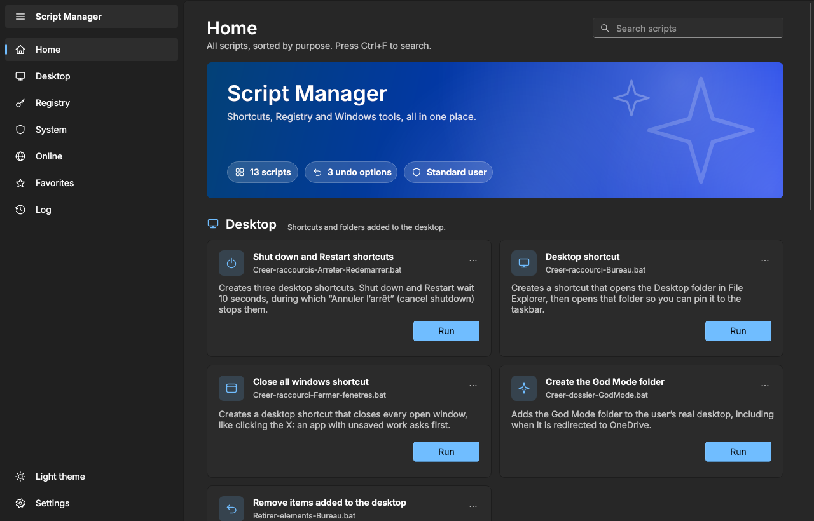
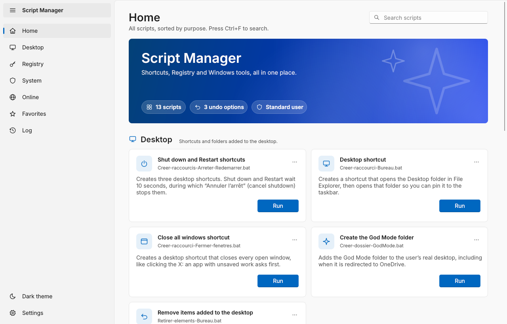
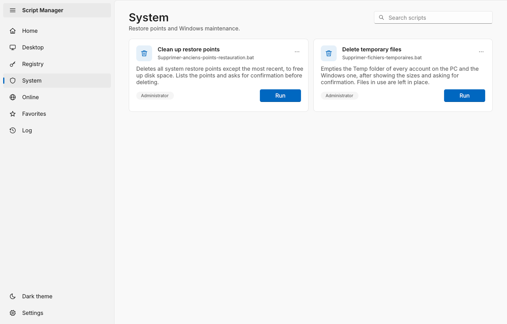
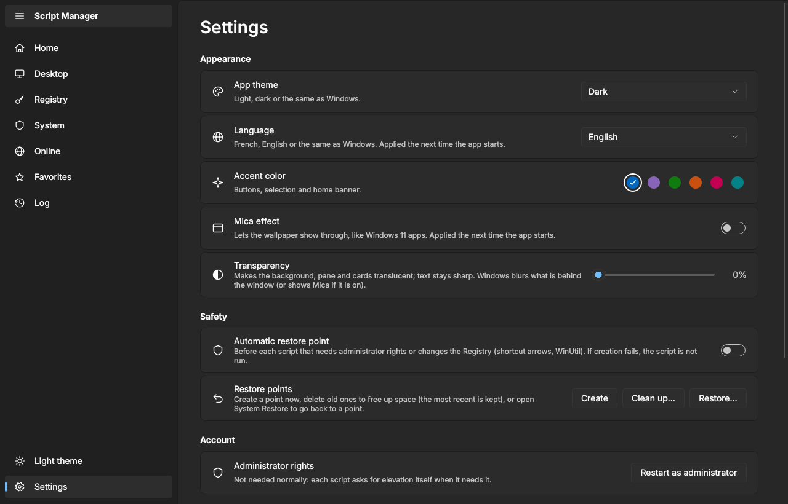
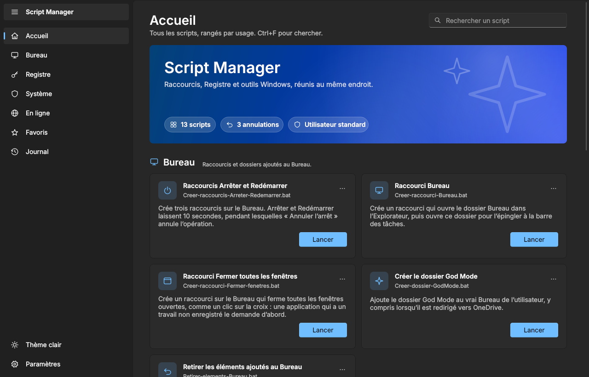
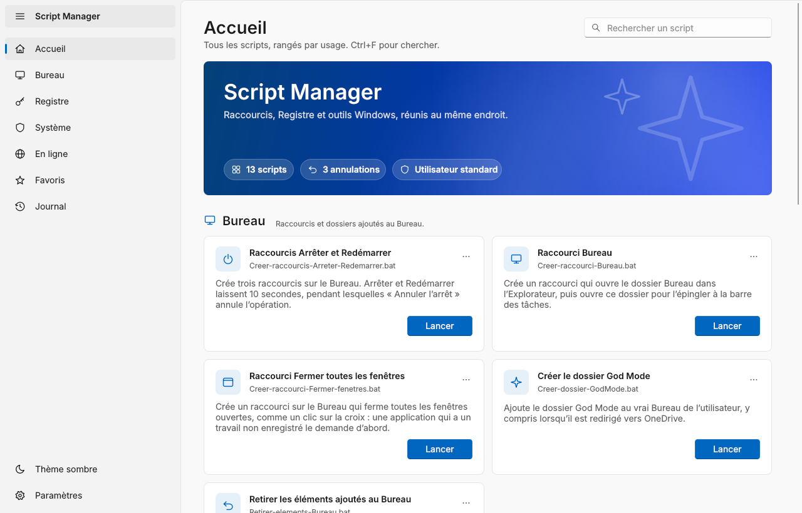
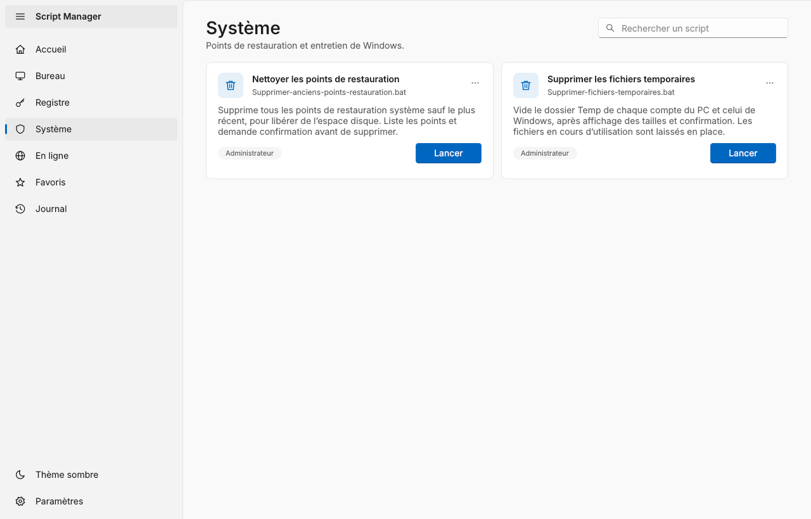
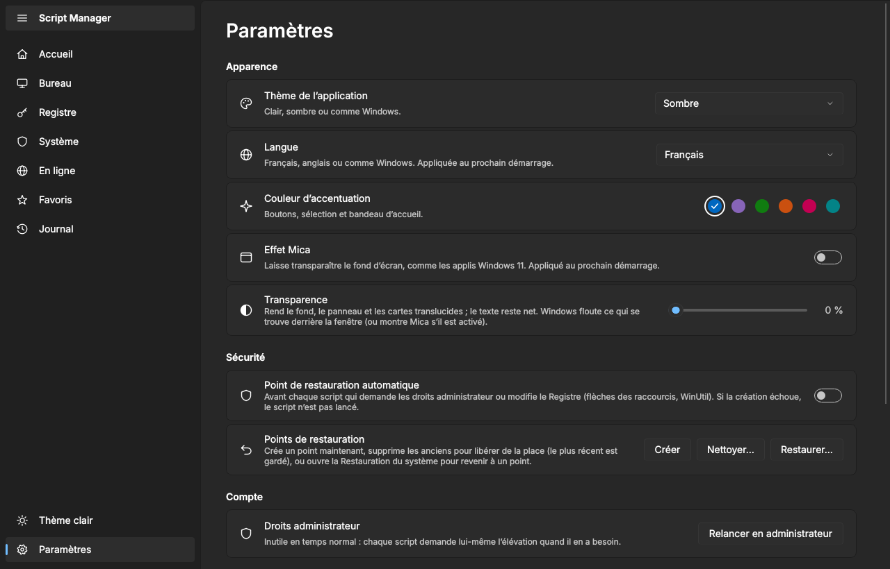

# Script Manager

[](https://github.com/Bulls64/Script-Manager/actions/workflows/ci.yml)
[](https://github.com/Bulls64/Script-Manager/releases/latest)
[](LICENSE)


**English** · [Français](#fr)

A Windows 11–style launcher for a set of Windows customization scripts: shutdown and desktop shortcuts, God Mode, shortcut arrows, animation delays, temporary files, restore points, [WinUtil](https://github.com/ChrisTitusTech/winutil) and [Super God Mode](https://github.com/ThioJoe/Windows-Super-God-Mode). Built with Python and PySide6, in English and French.

<p align="center">
  
  
</p>

## Features

- **One card per script**, sorted into Desktop, Registry, System, Online and Other. Each card shows whether the script needs administrator rights, changes the Registry or needs the Internet.
- **Followed launches**: the button shows "Running…" until the script window closes, then a notification gives the result (done, failed with its exit code, window closed). The Log page keeps the history.
- **Restore points**: on demand from a card's "…" menu, or automatically before every administrator or Registry script. If the point cannot be created, the script is not run.
- **Undo**: removing the shortcut arrows, shortening the animation delays and the desktop items each have a script that puts things back.
- **Favorites**: drop your own `.bat` or `.cmd` files in the `scripts` folder and add them as cards.
- **Appearance**: light, dark or system theme, six accent colors, Mica and a transparency slider on Windows 11.
- **Language**: English, French or the Windows language.
- **Updates**: checks this repository's releases at startup or on demand, and installs the new version in place.

<p align="center">
  
  
</p>

## Download and run

1. Download `Script-Manager-<version>.zip` from the [latest release](https://github.com/Bulls64/Script-Manager/releases/latest).
2. Extract it to a folder of your own on an internal drive, for example `C:\Tools\Script-Manager` (not Downloads, not a USB stick: see [Safety](#safety)).
3. Run `Script-Manager.exe`.

The EXE is not code-signed, so Windows SmartScreen may show "Windows protected your PC" the first time: click **More info**, then **Run anyway**. Keep `scripts.json` and the `scripts` folder next to the EXE: the app reads them at startup.

**From source** (Python 3.10 or later):

```bat
git clone https://github.com/Bulls64/Script-Manager.git
cd Script-Manager
py -3 -m pip install -r requirements.txt
py -3 Script-Manager.pyw
```

### Updates

Settings › Updates › "Check for updates at startup" (on by default) asks GitHub for the [latest release](https://github.com/Bulls64/Script-Manager/releases/latest) a few seconds after startup; "Check now" does the same on demand. Nothing is downloaded until you click **Install**. The app then:

1. downloads `Script-Manager-<version>.zip` and checks it against the `.sha256` file published with the release;
2. closes, copies the new files over the old ones and starts again (the log of this step is `%LOCALAPPDATA%\Scripts-Windows\update.log`).

Your settings, your favorite scripts and the entries you added to `scripts.json` are kept; the built-in scripts are replaced by the new ones. Installing in place only works for the EXE extracted from a release, in a folder you can write to. When running from source or from a local build, the button opens the release page instead (`git pull` updates a clone).

## Included scripts

| Script | What it does | Undo |
| --- | --- | --- |
| `Creer-raccourcis-Arreter-Redemarrer` | Shut down and Restart shortcuts (10-second delay) and a Cancel shutdown shortcut | `Retirer-elements-Bureau` |
| `Creer-raccourci-Bureau` | A shortcut to the Desktop folder, to pin to the taskbar | `Retirer-elements-Bureau` |
| `Creer-raccourci-Fermer-fenetres` | A shortcut that closes every window like the X button (unsaved work is asked about) | `Retirer-elements-Bureau` |
| `Creer-dossier-GodMode` | The God Mode folder on the desktop | `Retirer-elements-Bureau` |
| `Supprimer-fleche-raccourci` | Removes the arrow from shortcut icons (HKLM Registry, administrator) | `Restaurer-fleche-raccourci` |
| `Reduire-animations` | Caps the submenu, hover and taskbar preview delays at 200 ms (HKCU Registry) | `Restaurer-animations` |
| `Supprimer-anciens-points-restauration` | Deletes every restore point except the most recent, after confirmation (administrator) | Irreversible |
| `Supprimer-fichiers-temporaires` | Empties the Temp folder of every account and `C:\Windows\Temp`, after showing the sizes and asking (administrator) | Irreversible |
| `Lancer-Super-God-Mode` | Downloads and runs ThioJoe's [Super God Mode](https://github.com/ThioJoe/Windows-Super-God-Mode) | — |
| `Lancer-WinUtil` | Downloads and runs Chris Titus Tech's [WinUtil](https://github.com/ChrisTitusTech/winutil) as administrator | — |

Script file names and the messages shown in their console windows are in French; the cards are translated. Every `.bat` also works on its own with a double-click. Scripts that need PowerShell are self-contained `.bat` files: the PowerShell code sits at the end of the file, after a `#PS1#` line, and the batch part runs it.

<details>
<summary>Details: shortcut arrows, animation delays, temporary files</summary>

**Shortcut arrows.** `Supprimer-fleche-raccourci` copies `scripts\NoArrow\NoArrow.ico` to `%ProgramData%\Scripts-Windows` and sets it as the arrow icon (value `29` of `HKLM\…\Explorer\Shell Icons`). Before the first change it saves the original state in the same folder; `Restaurer-fleche-raccourci` puts it back. Both ask before restarting File Explorer, whose open windows close; answer N and the change appears at the next sign-in.

**Animation delays.** Windows has no setting for the length of its animations, only for the delays before something appears. `Reduire-animations` brings these down to 200 ms when they are longer:

| Value (HKCU) | Effect | Windows default |
| --- | --- | --- |
| `Control Panel\Desktop\MenuShowDelay` | Submenus opening | 400 ms |
| `Control Panel\Mouse\MouseHoverTime` | Hover: tooltips, previews | 400 ms |
| `…\Explorer\Advanced\ExtendedUIHoverTime` | Taskbar window previews | 400 ms |
| `…\Explorer\Advanced\DesktopLivePreviewHoverTime` | Desktop peek (taskbar corner) | — |

The original values are saved in `%LOCALAPPDATA%\Scripts-Windows\animations-origine.json` and restored by `Restaurer-animations`. No administrator rights are needed: only the current account changes.

**Temporary files.** `Supprimer-fichiers-temporaires` empties `AppData\Local\Temp` of every real account and `C:\Windows\Temp`. Files go straight away, not to the Recycle Bin. Files in use stay in place. Junctions and symbolic links are removed without being followed, so their targets are never touched.

</details>

## Safety

- **Restore points.** Settings › Safety › "Automatic restore point" creates one before every script marked `admin` or `registry`. Windows creates at most one point every 24 hours; when a recent one exists, the app says so and runs the script.
- **Administrator rights.** The app itself runs as a standard user. Scripts that need more ask for elevation themselves (UAC prompt).
- **Folder location.** Administrator scripts run from the `scripts` folder, so a program able to change that folder could get its code run with those rights. At startup, the app warns you if the folder is in Downloads, on a removable drive or on a network drive.
- **Third-party scripts.** WinUtil is downloaded from its [official GitHub release](https://github.com/ChrisTitusTech/winutil/releases/latest), its Authenticode signature is checked, and you are asked to confirm if it is not validly signed. Super God Mode is downloaded from its GitHub release and refreshed when the local copy is more than 7 days old. Neither is shipped with this project; they keep their own licenses (MIT and GPL-3.0).

## Add your own scripts

**As a favorite**: put a `.bat` or `.cmd` file in `scripts`, then click "Add a favorite". The card takes its title from the file name (`Flush-DNS-cache.bat` → "Flush DNS cache") and its description from the first `REM` or `::` comment.

**As a full card**: add an entry to `scripts.json` (no rebuild needed):

```json
{
  "title": "Titre de la carte",
  "title_en": "Card title",
  "filename": "My-script.bat",
  "description": "Ce que fait le script.",
  "description_en": "What the script does.",
  "admin": false,
  "registry": false,
  "internet": false,
  "category": "autres",
  "icon": "window"
}
```

- `title` and `description` are the French texts; `title_en` and `description_en` are optional and shown when the app is in English.
- `admin`, `registry` and `internet` default to `false`. `restore_point` defaults to `true`; set it to `false` to skip the automatic restore point.
- `category` is `bureau`, `registre`, `systeme`, `en_ligne` or `autres` (default).
- `icon` is one of `power`, `desktop`, `sparkle`, `undo`, `key`, `grid`, `toolbox`, `globe`, `folder`, `window` (default), `shield`, `settings`, `terminal`, `delete`.
- End the script with `exit /b <code>` so the app can show the real result.

## Settings and log

Stored in `%LOCALAPPDATA%\Scripts-Windows\` (the project's former name, kept so existing settings are not lost): `settings.json` for theme, language, accent, Mica, transparency and favorites, and `launcher.log` for the launch history shown on the Log page. Both folders open from Settings.

## Building and development

`build.bat` creates its own environment (`.venv-build`) with the pinned PySide6 and PyInstaller versions and builds `dist\Script-Manager\Script-Manager.exe` (PyInstaller "onedir").

```bat
py -3 -m venv .venv
.venv\Scripts\pip install -r requirements-dev.txt
.venv\Scripts\ruff check .
.venv\Scripts\mypy scripts_windows tests
.venv\Scripts\pytest
```

The code lives in `scripts_windows\`: `core.py` (manifest, settings, log, Windows calls, no Qt), `theme.py`, `icons.py`, `widgets.py`, `cards.py`, `pages.py` and `window.py` (interface), `i18n.py` and `translations.py` (translation). French is the source language: displayed text goes through `tr("…")` and its English translation goes in `translations.py`; a test reports any missing translation. UI tests run offscreen (`QT_QPA_PLATFORM=offscreen`) and also run on Linux, which is what the CI uses. Pushing a `v*` tag builds the release zip on GitHub Actions.

Bug reports and pull requests are welcome. Version history: [CHANGELOG.md](CHANGELOG.md).

## License

[MIT](LICENSE) © 2026 Bulls64. WinUtil (MIT) and Super God Mode (GPL-3.0) are downloaded at run time and are not part of this project.

---

<a id="fr"></a>

# Script Manager (français)

[English](#script-manager) · **Français**

Un lanceur au style de Windows 11 pour une série de scripts de personnalisation de Windows : raccourcis d’arrêt et du Bureau, God Mode, flèches des raccourcis, délais d’animation, fichiers temporaires, points de restauration, [WinUtil](https://github.com/ChrisTitusTech/winutil) et [Super God Mode](https://github.com/ThioJoe/Windows-Super-God-Mode). Écrit en Python avec PySide6, en français et en anglais.

<p align="center">
  
  
</p>

## Fonctionnalités

- **Une carte par script**, rangée dans Bureau, Registre, Système, En ligne ou Autres. Chaque carte indique si le script demande les droits administrateur, modifie le Registre ou a besoin d’Internet.
- **Lancements suivis** : le bouton affiche « En cours… » jusqu’à la fermeture de la fenêtre du script, puis une notification donne le résultat (terminé, échec avec son code, fenêtre fermée). La page Journal garde l’historique.
- **Points de restauration** : à la demande depuis le menu « … » d’une carte, ou automatiquement avant chaque script administrateur ou Registre. Si le point ne peut pas être créé, le script n’est pas lancé.
- **Annulation** : la suppression des flèches, la réduction des délais d’animation et les éléments du Bureau ont chacun un script qui remet tout en place.
- **Favoris** : dépose tes propres `.bat` ou `.cmd` dans le dossier `scripts` et ajoute-les en cartes.
- **Apparence** : thème clair, sombre ou système, six couleurs d’accentuation, Mica et curseur de transparence sous Windows 11.
- **Langue** : français, anglais ou langue de Windows.
- **Mises à jour** : vérifie les releases de ce dépôt au démarrage ou à la demande, et installe la nouvelle version sur place.

<p align="center">
  
  
</p>

## Télécharger et lancer

1. Télécharge `Script-Manager-<version>.zip` depuis la [dernière release](https://github.com/Bulls64/Script-Manager/releases/latest).
2. Décompresse-le dans un dossier à toi, sur un disque interne, par exemple `C:\Outils\Script-Manager` (pas dans Téléchargements ni sur une clé USB : voir [Sécurité](#sécurité)).
3. Lance `Script-Manager.exe`.

L’EXE n’est pas signé : au premier lancement, SmartScreen peut afficher « Windows a protégé votre ordinateur ». Clique sur **Informations complémentaires**, puis **Exécuter quand même**. Garde `scripts.json` et le dossier `scripts` à côté de l’EXE : l’application les lit au démarrage.

**Depuis les sources** (Python 3.10 ou plus) :

```bat
git clone https://github.com/Bulls64/Script-Manager.git
cd Script-Manager
py -3 -m pip install -r requirements.txt
py -3 Script-Manager.pyw
```

### Mises à jour

Paramètres › Mises à jour › « Rechercher les mises à jour au démarrage » (activé par défaut) interroge GitHub sur la [dernière release](https://github.com/Bulls64/Script-Manager/releases/latest) quelques secondes après le démarrage ; « Rechercher » fait la même chose à la demande. Rien n’est téléchargé tant que tu n’as pas cliqué sur **Installer**. L’application :

1. télécharge `Script-Manager-<version>.zip` et le vérifie avec le fichier `.sha256` publié avec la release ;
2. se ferme, copie les nouveaux fichiers par-dessus les anciens et redémarre (le journal de cette étape est `%LOCALAPPDATA%\Scripts-Windows\update.log`).

Tes réglages, tes scripts en favori et les entrées que tu as ajoutées à `scripts.json` sont conservés ; les scripts intégrés sont remplacés par les nouveaux. L’installation sur place ne fonctionne que pour l’EXE décompressé d’une release, dans un dossier où tu peux écrire. Depuis les sources ou un build local, le bouton ouvre la page de la release (`git pull` met un clone à jour).

## Scripts inclus

| Script | Rôle | Annulation |
| --- | --- | --- |
| `Creer-raccourcis-Arreter-Redemarrer` | Raccourcis Arrêter et Redémarrer (délai de 10 s) et Annuler l’arrêt | `Retirer-elements-Bureau` |
| `Creer-raccourci-Bureau` | Raccourci vers le dossier Bureau, à épingler à la barre des tâches | `Retirer-elements-Bureau` |
| `Creer-raccourci-Fermer-fenetres` | Raccourci qui ferme chaque fenêtre comme la croix (les travaux non enregistrés sont demandés) | `Retirer-elements-Bureau` |
| `Creer-dossier-GodMode` | Dossier God Mode sur le Bureau | `Retirer-elements-Bureau` |
| `Supprimer-fleche-raccourci` | Retire la flèche des raccourcis (Registre HKLM, administrateur) | `Restaurer-fleche-raccourci` |
| `Reduire-animations` | Délais des sous-menus, du survol et des aperçus ramenés à 200 ms au plus (Registre HKCU) | `Restaurer-animations` |
| `Supprimer-anciens-points-restauration` | Supprime tous les points de restauration sauf le plus récent, après confirmation (administrateur) | Irréversible |
| `Supprimer-fichiers-temporaires` | Vide le dossier Temp de chaque compte et `C:\Windows\Temp`, après affichage des tailles et confirmation (administrateur) | Irréversible |
| `Lancer-Super-God-Mode` | Télécharge et lance [Super God Mode](https://github.com/ThioJoe/Windows-Super-God-Mode) de ThioJoe | — |
| `Lancer-WinUtil` | Télécharge et lance [WinUtil](https://github.com/ChrisTitusTech/winutil) de Chris Titus Tech en administrateur | — |

Chaque `.bat` fonctionne aussi seul, par double-clic. Les scripts qui ont besoin de PowerShell sont des `.bat` autonomes : le code PowerShell est à la fin du fichier, après une ligne `#PS1#`, et la partie batch l’exécute.

<details>
<summary>Détails : flèches des raccourcis, délais d’animation, fichiers temporaires</summary>

**Flèches des raccourcis.** `Supprimer-fleche-raccourci` copie `scripts\NoArrow\NoArrow.ico` dans `%ProgramData%\Scripts-Windows` et l’indique à Windows comme icône de la flèche (valeur `29` de `HKLM\…\Explorer\Shell Icons`). Avant la première modification, il enregistre l’état d’origine dans ce même dossier ; `Restaurer-fleche-raccourci` le remet. Les deux demandent confirmation avant de redémarrer l’Explorateur, dont les fenêtres ouvertes se ferment ; en répondant N, le changement apparaît à la prochaine ouverture de session.

**Délais d’animation.** Windows ne permet pas de régler la durée de ses animations, seulement les délais avant un affichage. `Reduire-animations` ramène à 200 ms ceux qui dépassent :

| Valeur (HKCU) | Effet | Défaut de Windows |
| --- | --- | --- |
| `Control Panel\Desktop\MenuShowDelay` | Ouverture des sous-menus | 400 ms |
| `Control Panel\Mouse\MouseHoverTime` | Survol : info-bulles, aperçus | 400 ms |
| `…\Explorer\Advanced\ExtendedUIHoverTime` | Aperçus des fenêtres dans la barre des tâches | 400 ms |
| `…\Explorer\Advanced\DesktopLivePreviewHoverTime` | Aperçu du Bureau (coin de la barre des tâches) | — |

Les valeurs d’origine sont enregistrées dans `%LOCALAPPDATA%\Scripts-Windows\animations-origine.json` et remises par `Restaurer-animations`. Aucun droit administrateur : seul le compte courant change.

**Fichiers temporaires.** `Supprimer-fichiers-temporaires` vide `AppData\Local\Temp` de chaque compte réel et `C:\Windows\Temp`. Les fichiers ne passent pas par la Corbeille. Un fichier ouvert reste en place. Les jonctions et liens symboliques sont retirés sans être suivis : leur cible n’est jamais touchée.

</details>

## Sécurité

- **Points de restauration.** Paramètres › Sécurité › « Point de restauration automatique » en crée un avant chaque script marqué `admin` ou `registry`. Windows n’en crée qu’un toutes les 24 heures ; quand un point récent existe, l’application le signale et lance le script.
- **Droits administrateur.** L’application tourne en utilisateur standard. Les scripts qui ont besoin de plus demandent eux-mêmes l’élévation (fenêtre UAC).
- **Emplacement du dossier.** Les scripts administrateur sont lancés depuis le dossier `scripts` : un programme capable de le modifier pourrait faire exécuter son code avec ces droits. Au démarrage, l’application prévient si le dossier est dans Téléchargements, sur un lecteur amovible ou sur un lecteur réseau.
- **Scripts tiers.** WinUtil est téléchargé depuis sa [release GitHub officielle](https://github.com/ChrisTitusTech/winutil/releases/latest), sa signature Authenticode est vérifiée, et une confirmation est demandée s’il n’est pas signé valablement. Super God Mode est téléchargé depuis sa release GitHub et mis à jour quand la copie locale a plus de 7 jours. Aucun des deux n’est fourni avec ce projet ; ils gardent leurs licences (MIT et GPL-3.0).

## Ajouter tes scripts

**En favori** : place un `.bat` ou un `.cmd` dans `scripts`, puis clique sur « Ajouter un favori ». La carte prend son titre dans le nom du fichier (`Vider-cache-DNS.bat` → « Vider cache DNS ») et sa description dans le premier commentaire `REM` ou `::`.

**En carte complète** : ajoute une entrée à `scripts.json` (sans reconstruire l’EXE), sur le modèle de l’exemple de la partie anglaise. `title` et `description` sont les textes français ; `title_en` et `description_en`, facultatifs, s’affichent quand l’interface est en anglais. `admin`, `registry` et `internet` valent `false` par défaut ; `restore_point` vaut `true`, et `false` évite le point de restauration automatique. `category` vaut `bureau`, `registre`, `systeme`, `en_ligne` ou `autres` (par défaut) ; `icon` est l’une des icônes listées plus haut. Termine le script par `exit /b <code>` pour que l’application affiche le vrai résultat.

## Réglages et journal

Dans `%LOCALAPPDATA%\Scripts-Windows\` (ancien nom du projet, gardé pour ne pas perdre les réglages existants) : `settings.json` pour le thème, la langue, l’accent, Mica, la transparence et les favoris, et `launcher.log` pour l’historique affiché dans la page Journal. Les deux dossiers s’ouvrent depuis les Paramètres.

## Construction et développement

`build.bat` crée son propre environnement (`.venv-build`) avec les versions fixées de PySide6 et PyInstaller, et produit `dist\Script-Manager\Script-Manager.exe` (PyInstaller « onedir »). Les commandes de développement et l’organisation du code sont décrites dans la [partie anglaise](#building-and-development). Le français est la langue source : un texte affiché passe par `tr("…")` et sa traduction anglaise va dans `translations.py`. Pousser un tag `v*` construit l’archive de release sur GitHub Actions.

Les rapports de bug et les pull requests sont les bienvenus. Historique des versions : [CHANGELOG.md](CHANGELOG.md).

## Licence

[MIT](LICENSE) © 2026 Bulls64. WinUtil (MIT) et Super God Mode (GPL-3.0) sont téléchargés à l’exécution et ne font pas partie de ce projet.
